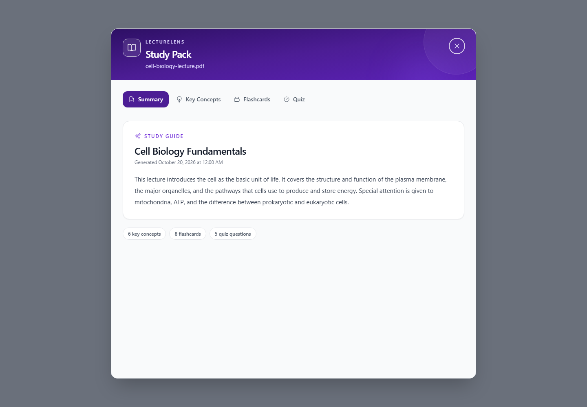
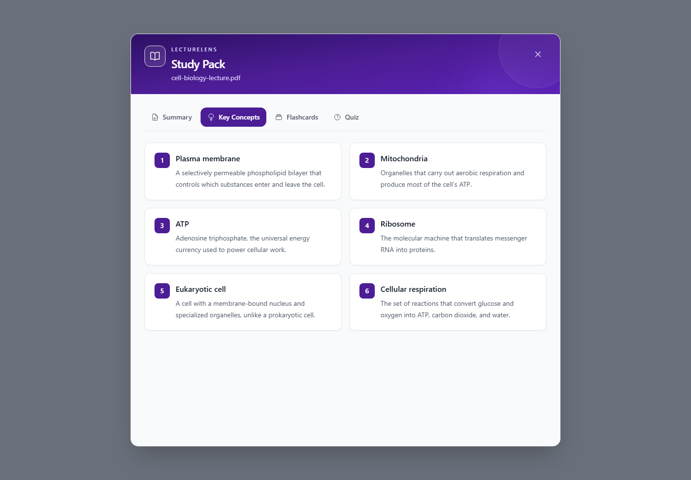

# LectureLens

LectureLens is a serverless study companion for lecture PDFs. Upload a lecture, chat with the material, and generate a **Study Pack** containing a summary, key concepts, flashcards, and a multiple-choice quiz.

Built on AWS with Cognito, API Gateway, Lambda, DynamoDB, S3, and SQS. The frontend is served over HTTPS from a private S3 bucket through an API Gateway HTTP API. Amazon Bedrock is optional; the default zero-cost mode uses a deterministic local study engine.

| Study Pack | Key concepts |
| --- | --- |
|  |  |

## What it does

- **Chat with a PDF** — ask questions and get answers grounded in the document, with page references.
- **Study Pack** — one click produces:
  - a concise summary
  - 5–8 key concepts
  - 8–12 flashcards
  - a 5-question practice quiz with explanations
- **Asynchronous generation** — the API returns immediately, the browser polls a status endpoint, and a worker Lambda builds the Study Pack. This avoids the API Gateway 29-second timeout.
- **Private by default** — documents live in a private S3 bucket; the frontend is served from a private bucket by a small Lambda behind API Gateway HTTPS, with no public object access.
- **Admin-created users** — Cognito is configured for a small private demo, with no public sign-up.

## Architecture

```
Browser (React + Vite)
  │
  ├── Cognito sign-in
  ▼
API Gateway (REST, Cognito authorizer)
  ├── document upload / list / chat / delete
  ├── POST /doc/{id}/study-pack  ──► SQS StudyPackQueue
  └── GET  /doc/{id}/study-pack  ──► DynamoDB
                                         ▲
                                         │
                              GenerateStudyPack Lambda
                              ├── reads PDF from S3
                              ├── Bedrock Converse or local study engine
                              └── stores pack + status

Frontend hosting: private S3 bucket ◄── Lambda + API Gateway HTTP API (HTTPS)
```

CloudFront is optional. New Free-plan accounts may need account verification before
creating a distribution, so the default deployment uses the API Gateway HTTPS host.
`infra/frontend-cloudfront.yaml` is kept for accounts that have CloudFront enabled.

The PDF indexing pipeline extracts text with `pypdf`, creates deterministic local embeddings by default (or Titan embeddings in Bedrock mode), and stores a JSON index in S3. Chat retrieval uses cosine similarity over that index, then answers from the retrieved passages or calls the Bedrock **Converse** API when enabled. The Lambda dependencies are pure Python, so `sam build` works on Windows without Docker.

## Quick start

See **[DEPLOYMENT.md](DEPLOYMENT.md)** for the full walkthrough. The short version:

```powershell
# 1. Configure AWS credentials and confirm the Free plan is active
aws sts get-caller-identity
.\scripts\check-credits.ps1

# 2. Build and deploy the backend (local AI mode = no Bedrock calls)
.\scripts\deploy-backend.ps1 -AiMode local

# 3. Create a login user
.\scripts\create-demo-user.ps1 -Email you@example.com

# 4. Build and deploy the frontend to private S3 + HTTPS API host
.\scripts\deploy-frontend.ps1
```

The frontend script prints the public HTTPS URL. Sign in with the demo user and upload [`examples/cell-biology-lecture.pdf`](examples/cell-biology-lecture.pdf) to try chat and the Study Pack.

## Local frontend development

After the backend is deployed, create `frontend/.env.development` using the stack outputs:

```text
VITE_REGION=us-east-1
VITE_API_REGION=us-east-1
VITE_API_ENDPOINT=https://<api-id>.execute-api.us-east-1.amazonaws.com/dev/
VITE_USER_POOL_ID=us-east-1_xxxxxxxxx
VITE_USER_POOL_CLIENT_ID=xxxxxxxxxxxxxxxxxxxxxxxxxx
```

Then:

```powershell
cd frontend
npm ci
npm run dev
```

## Project structure

```
backend/
  template.yaml                 SAM stack (API, auth, storage, queues, Lambdas)
  src/
    generate_embeddings/        PDF -> text chunks -> local embeddings (or Titan) -> index.json
    generate_response/          Retrieval + local answer or Bedrock Converse chat
    generate_study_pack/        Async Study Pack worker
    request_study_pack/         Starts a Study Pack job
    get_study_pack/             Polls Study Pack status/result
    ...                         upload, list, delete, conversation routes
  tests/                        Pure-Python unit tests
frontend/
  src/components/StudyPackModal.tsx   Summary / concepts / flashcards / quiz UI
  src/common/studyPackApi.ts          Typed Study Pack API client
  src/routes/                         Documents, chat, layout
infra/frontend.yaml             Private S3 + Lambda + HTTP API hosting stack
infra/frontend-cloudfront.yaml  Optional CloudFront (OAC) hosting template
examples/cell-biology-lecture.pdf  Sample 4-page lecture for the demo
scripts/                        PowerShell deployment and verification helpers
docs/                           README screenshots
DEPLOYMENT.md                   Step-by-step AWS deployment guide
```

## Configuration

| Setting | Default | Notes |
|---|---|---|
| Stack region | `us-east-1` | Override with `-Region` |
| AI mode | `local` | `local` (no Bedrock), `auto` (try Bedrock, then fall back), `bedrock` (require Bedrock) |
| Chat / Study Pack model | `amazon.nova-pro-v1:0` | Bedrock mode only; must support Converse |
| Embedding model | `amazon.titan-embed-text-v2:0` | Bedrock mode only; local mode uses deterministic local hashing |
| Bedrock region | `us-east-1` | Used only in `auto` or `bedrock` mode |
| Frontend hosting | S3 + Lambda + HTTP API | Created by `infra/frontend.yaml`; CloudFront template is optional |

The SAM template exposes `AiMode`, `ModelId`, `EmbeddingModelId`, and `BedrockRegion` parameters. `AiMode` defaults to `local` because the Free plan does not include Bedrock:

```powershell
.\scripts\deploy-backend.ps1 -AiMode local
.\scripts\deploy-backend.ps1 -AiMode auto    # tries Bedrock, falls back locally
.\scripts\deploy-backend.ps1 -AiMode bedrock # requires model access
```

## Tests

```powershell
# Run every local check: 84 backend tests, SAM validate/build,
# cfn-lint, and the frontend build/lint.
powershell -ExecutionPolicy Bypass -File .\scripts\verify-local.ps1

# Pure-Python core tests only (no AWS credentials required)
.\.venv\Scripts\python.exe -m unittest discover -s backend\tests -p "test_*.py" -v

# Frontend type check, production build, and lint
cd frontend
npm ci
npm run build
npm run lint
```

## Cost notes

LectureLens is designed to run entirely on the **AWS Free plan**: no paid upgrade, no out-of-pocket charges. The account includes **$100 in credits** (plus activity credits), and the plan closes when the credits or term end instead of billing you.

**Amazon Bedrock is not included in the Free plan.** The default `AiMode=local` makes no Bedrock calls, so the demo has no model-token cost. Lambda, DynamoDB, SQS, Cognito, and CloudWatch have Always Free allowances; S3 and API Gateway draw from the credit balance. The frontend uses a private S3 bucket and a small Lambda behind an HTTP API; CloudFront is not required. Keep using small PDFs and avoid repeated bulk uploads.

Run `.\scripts\check-credits.ps1` to see the remaining balance. For AWS India accounts, complete payment-method verification (UPI AutoPay or card) in Billing → Payment preferences to activate services; this is identity verification, not a paid upgrade. See [DEPLOYMENT.md](DEPLOYMENT.md) for details and cleanup.

## Attribution

The base application is [`aws-samples/serverless-pdf-chat`](https://github.com/aws-samples/serverless-pdf-chat), licensed under MIT-0. LectureLens adds the Study Pack pipeline and UI, LectureLens branding, a pure-Python local AI path, and an AWS-hosted frontend (private S3 + Lambda + HTTP API, with an optional CloudFront template).
